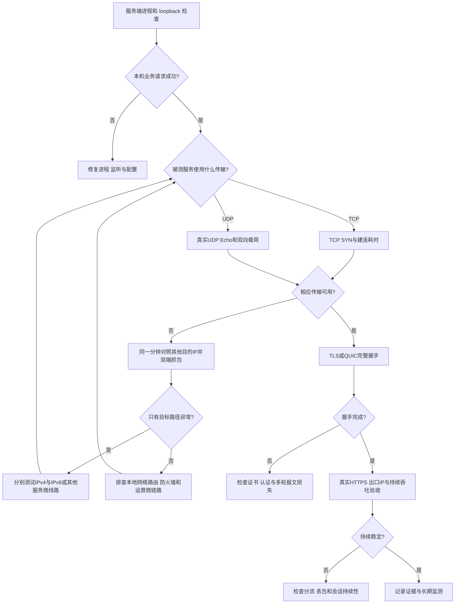

# 一台 RackNerd VPS 折腾三天，最后靠免费 IPv6 救活：代理排障避坑实录

> 时间：2026 年 10 月 15 日至 17 日  
> 环境：RackNerd 洛杉矶 VPS、Ubuntu 24.04、Mac、iPhone、Hysteria2  
> 关键词：TCP 丢包、QUIC、UDP、Cloudflare、IPv6、抓包、证书续期、macOS 路由


  

> **快速结论：** 当 IPv4 入口的 TCP/UDP 实际通信持续异常时，值得先核查服务商是否提供原生 IPv6，再对 IPv6 入口进行完整的 HTTPS 业务验收。本案对照实验中，同一服务器改用 IPv6 后通过 20/20 次 HTTPS 测试；后续用户也确认 iPhone 手机端验收成功，手机端的分项测试数据未单独记录。

> **从这份案例延伸出的开源工具：** [PathTrial](https://github.com/gaochenyang666-droid/PathTrial)（Rust / MIT）把 DNS、TCP、TLS、HTTP、UDP Echo 与代理链路检测整理成可复核的 JSON / Markdown 报告。本文是 **2026 年 10 月的原始排障记录**，历史数字并非 PathTrial 在当时测得。参见 [用 PathTrial 复现排障流程](docs/使用-PathTrial-复现排障.md)。

**三天时间线：** 10 月 15 日旧服务器部署与代理失败 → 10 月 16 日分层抓包、换机和 CDN/UDP 验证 → 10 月 16 日夜间申请并打通 IPv6；10 月 17 日完成证书和稳定性收尾。

**阅读导航：** [故障演变](#1-最开始我以为是软件没装好) · [抓包定位](#2-真正有用的排查是把连接拆成几层) · [失败方案](#3-换机cdnudp我都试过) · [IPv6 最终解法](#4-最终解法向-racknerd-申请原生-ipv6) · [可复用排障清单](docs/排障检查清单.md) · [完整测试记录](docs/测试数据与证据.md) · [长期维护清单](docs/维护与后续验收.md) · [PathTrial 实测指南](docs/使用-PathTrial-复现排障.md)

> **隐私说明：** 为避免泄露个人服务器和账号信息，公开版本省略公网地址、认证口令、私钥及域名。本文公开的数据来自本次项目记录，其余推断已标注证据边界。

## 先说结论

这三天里，我清理过代理内核，部署过 REALITY、WebSocket、gRPC，换过端口、宿主机，试过 Cloudflare Tunnel，又把希望放到 UDP 和 Hysteria2 上。它们最终都没能修好原来的 **IPv4 入口**。

真正的转机来自 RackNerd 官方知识库里的一条信息：**洛杉矶机房可以申请原生 IPv6**。我提交工单，拿到免费 IPv6 地址后，在同一台机器、同一套 Hysteria2 服务和同一个客户端上，把入口从 IPv4 换成 IPv6，随后完成 **20/20 次真实 HTTPS 请求**。但最初的 IPv4 和 IPv6 测试相隔约一个半小时，因此只说明配置和入口的主要差异，不能当作严格同分钟对照。10 月 17 日再做同分钟 TCP 22 对照，IPv4 **8/10、平均 2476 ms**，IPv6 **10/10、平均 323 ms**，进一步补强了路径差异的证据。

这篇记录想提醒后来者：**遇到代理连接失败，先验证网络路径能否完成真实业务握手，再决定要不要重装或换协议。**

## 1. 最开始，我以为是软件没装好

我的目标很简单：用这台 VPS 给 Mac 和 iPhone 提供稳定的代理连接，国内流量直连，其他流量按规则走代理。

一开始，我把能检查的软件层面基本都处理了：统一代理内核、清理旧程序、检查域名解析、签发 TLS 证书并配置自动续期。服务器本机测试 REALITY 和 WebSocket 都正常。

但一回到 Mac，代理请求 **0/10 全败**。奇怪的是，同一时段访问 GitHub、微软、维基百科、Oracle 等其他海外目标，成功率接近 100%。于是我开始怀疑：问题是否只和这台服务器的 IP 有关？

## 2. 真正有用的排查，是把连接拆成几层

我没有再只看“服务是否 active”，而是把客户端、网络路径和服务器分别验证。

| 测试 | 结果 | 说明 |
| --- | --- | --- |
| 服务器本机 loopback | 全部通过 | 服务在本机可运行 |
| 六个海外探测点访问服务器端口 | 很快成功 | 端口并非对所有外部来源不可达 |
| Mac 向服务器仅发送 TCP SYN | 失败情况与代理相近 | 应用层协议不是必要触发条件 |
| 关闭 Mac 的客户端 VPN 后重测 | 结果无明显变化 | 不能简单归因于本地 VPN |
| 客户端与服务器双端抓包 | SYN 到达服务器，服务器发出 SYN-ACK，Mac 只收到约一半 | 问题集中在 TCP 往返路径 |
| 同一分钟访问其他海外对照目标 | 接近全部成功 | 不能简单归因于 Mac 整体断网 |

这些证据让我停止在 REALITY、WebSocket 和 gRPC 之间反复切换。它们都依赖 TCP，最基础的 TCP 连接都不稳定，换应用层协议很难解决根因。

这里需要强调：**抓包能证明报文在哪一侧被观察到，不能单凭这些测试锁定具体是哪家运营商、哪台设备在丢包，更不能直接断定是人为封锁。**

## 3. 换机、CDN、UDP，我都试过

我重建过服务器，换过物理宿主机和上游路径，IPv4 连通问题依然存在。

Cloudflare 也没带来突破：测试的边缘路径上，IPv4 TCP **0/20**；IPv6 虽然有 **18/20** 次 TCP 能建立，但 TLS 握手 **0/20**；更换 SNI 也没有实质改善。Quick Tunnel 的实际验收同样失败。

这让我意识到一个常见误区：**CDN 只有在客户端能稳定连上 CDN 边缘、边缘也能连上源站时才有意义。** 如果客户端到边缘的连接就失败，再加一层 CDN 没有帮助。我的结论只针对当时测试过的节点和路径，并不代表 Cloudflare 在所有网络环境里都不可用。

之后我尝试 UDP。最初向未监听的端口发送数据，看到 **10/10** 成功，一度以为 UDP 可以救场。但服务器实际返回的是 **ICMP 端口不可达**，并非 UDP 应用载荷。真正部署 UDP Echo 和 Hysteria2 之后，结果很不乐观：

| 同阶段测试 | 成功率 |
| --- | ---: |
| UDP 64 字节探测（ICMP 错误回程） | 10/10 |
| UDP 1200 字节探测（ICMP 错误回程） | 9/10 |
| 真实 UDP Echo（39001 端口） | 1/5（另有 3/20、0/15） |
| Hysteria2 / QUIC 隧道握手 | 0/10 |
| TCP 22（10 月 16 日同分钟配对） | 1/10（另一次三连探测为 1/3） |
| 无效 QUIC 报文打向 Hysteria2 端口 39000 | 0/12 次收到响应；此探测不用于判断 Echo 成功率 |

Hysteria2 的 systemd 服务正常，UDP 端口也在监听，但客户端 10 次均在 QUIC 握手阶段超时，连认证阶段都没进入。

**教训：** UDP 探测能收到 ICMP 回包，不代表真实 UDP 会话可用；发送无效 QUIC 数据包而未得到响应，也不能当作有效握手失败证据。端口监听成功，同样不代表代理隧道可用。

## 4. 最终解法：向 RackNerd 申请原生 IPv6

转机来自阅读官方知识库。我发现当时的 RackNerd 洛杉矶 VPS 可以免费申请原生 IPv6，于是提交了工单。

拿到 IPv6 地址后，服务器端已将静态地址写入 `/etc/netplan/`，我核对地址、路由及 `sysctl`，确认没有启用 `disable_ipv6=1`。在**静态 IPv6 默认路由已配置、不会依赖路由器通告（RA）获取默认网关**的前提下，关闭 IPv6 的 `autoconf`、`accept_ra`，避免额外的 RA 默认路由与现有路由竞争，并执行 `sysctl -p` 使 `/etc/sysctl.conf` 中的设置生效。随后让客户端通过 IPv6 连接原有的 Hysteria2 服务。

下面展示的是**本案例的检查要点，切勿在依赖 SLAAC/RA 的服务器上直接套用**：

```bash
# 先核对静态 IPv6 地址与默认路由，务必保留 VNC/其他管理入口
ip -6 address show
ip -6 route show default

# 检查 IPv6 禁用状态和 RA / 自动配置设置
sysctl net.ipv6.conf.all.disable_ipv6
sysctl net.ipv6.conf.default.disable_ipv6
sysctl net.ipv6.conf.all.accept_ra
sysctl net.ipv6.conf.all.autoconf

# 仅当已经评估 /etc/sysctl.conf 的修改适合当前静态网络配置
sudo sysctl -p
```

若设置写入 `/etc/sysctl.d/*.conf`，应使用 `sudo sysctl --system` 读取相应配置；实际写入的键、网卡名及生效范围应按服务器原配置核对。**netplan 地址配置中出现 `/64` 掩码，表示该接口使用的前缀长度与邻居可达范围，并不意味着服务商把整个 `/64` 前缀路由并授权给这台 VPS 自主分配。** 远程修改 IPv6 路由存在失联风险，建议在 VNC 中操作。

**这次没有重新换代理协议，也没有再买服务器。**

**验收摘要（精简版）**。完整数据、目标地址、请求构成、性能与同分钟 IPv4/IPv6 对照，以 [测试数据与证据](docs/测试数据与证据.md) 为准，避免多处复制同一张表造成漂移。

| 指标 | 结果 |
| --- | --- |
| IPv6 真实 HTTPS（同一目标 `api.github.com`） | 20/20 |
| IPv6 持续业务验收 | 10 分钟，68/68 |
| 10 月 17 日同分钟 TCP 22 对照 | IPv4 8/10、平均 2476 ms；IPv6 10/10、平均 323 ms |
| iPhone 手机端自测 | 用户确认验收成功，分项指标未记录 |

**时间差说明：** 10 月 16 日的 IPv4 失败记录约在 19:2x，IPv6 验收约在 21:0x，存在约一个半小时的间隔，期间路径可能变化。新增的 10 月 17 日同分钟 TCP 22 对照减少了这一混杂因素，但 TCP 22 指标仍不能单独代表 UDP/QUIC、吞吐或代理业务验收。IPv4 **8/10 建连成功仍伴随约 2.5 秒平均耗时**，对延迟敏感的应用依旧可能明显受影响；不能仅凭这组 TCP 数据断言 QUIC 必然失败。

当然，这不保证所有 RackNerd 套餐、机房或网络都能免费申请 IPv6，也不保证 IPv6 永远稳定。申请条件要以自己所在机房和当时的官方答复为准。


### 官方依据与适用条件

RackNerd 官方知识库《[Do you provide IPv6?](https://my.racknerd.com/index.php?rp=/knowledgebase/25/Do-you-provide-IPv6-.html)》（2026 年 10 月 16 日查阅）列出五个可分配免费原生 IPv6 的位置：**洛杉矶、犹他、多伦多（加拿大）、斯特拉斯堡（法国）、都柏林（爱尔兰）**。购买 VPS 后可提交工单申请，最多 **100 个 IPv6 地址**，免费分配；实际资格以服务商当时答复为准。

**地址数量与地址段要分清：** 本次工单中客服说明，VPS 的 IPv6 通过不同 VLAN 路由，按**单个 IPv6 地址**分配，**不向 VPS 路由整个 /64 前缀**。知识库另外提到，符合条件的**独立服务器**客户可申请 /64 前缀。申请多个单地址，并不意味着获得一个可自主分配的 /64 网段。

申请后还应逐一确认：服务器系统已有 IPv6 地址、默认 IPv6 路由有效、防火墙允许所需 UDP 端口、客户端网络能访问 IPv6，并且客户端使用的是正确的 IPv6 入口。

## 5. 还有个隐藏的坑：证书续期

代理跑通后，我把证书续期流程从旧服务器迁了过来，却发现 Let's Encrypt API 所在的路径也有访问问题，直接连接会卡住。

进一步排查发现，ACME 目录端点 `acme-v02.api.letsencrypt.org` 在当时解析到了 Cloudflare 网络地址；恰好此前同一条客户端到 Cloudflare 的路径已测得 IPv4 TCP 基本全败、IPv6 TLS 全败，`acme.sh` 因访问 ACME API 失败而报 `Cannot init API`。这是本次测试环境的路径关联，**并不意味着所有地区的 Let's Encrypt 都存在问题**。

解决方式是在 Mac 上让证书签发进程使用可用的本地代理隧道，同时通过 `NO_PROXY` 排除 DNS 提供商的 API 域名，避免无谓地让 DNS 验证 API 也经过问题路径。下方仅演示环境变量的作用范围，`dns-api.example.invalid` 是占位符，必须根据 DNS 插件实际连接的主机名设置：

```bash
ALL_PROXY=socks5h://127.0.0.1:1080 \
NO_PROXY=dns-api.example.invalid \
  acme.sh --renew -d example.com
```

上述示例不包含实际域名、凭据与自动化任务；使用前需验证所用 `acme.sh` 版本、HTTP 工具及 DNS 插件确实遵循代理环境变量。私钥仍保留在 Mac。强制续期、证书部署、服务重启以及复测全部成功，新证书有效期延续到了 **2027 年 1 月**。之后卸载了不再需要的 `cloudflared`。

这里必须保留一个待验证项：**一次强制续期成功，不足以证明长期完全无人值守。** 如果续期依赖 Mac 在线和本地隧道运行，自动化就仍有外部依赖，需要单独处理。

## 5.1 安全现状：服务跑通之后还要收紧暴露面

本轮核查时，服务器 **UFW 未启用，iptables 默认策略放行**；IPv6 上 Hysteria2 的 **39000/udp 暴露于公网**，使用共享口令认证。这是当时配置的安全风险记录，**不代表我们现在已经启用防火墙或完成加固**。共享密码需要足够长、随机、妥善保存，发现泄露应及时轮换。Hysteria2 的 masquerade（伪装响应）和按需使用的混淆参数可以调整被探测时的表现，但不能提供匿名或免探测保证。

安全收尾需要先确认 VNC 和现有 SSH 管理路径可用，列清 SSH 实际端口、IPv4/IPv6 规则，再按最小开放原则保留管理端口及 `39000/udp`，其余入站按需拒绝。**远程直接启用默认拒绝规则可能切断管理通道，请勿照抄未经核对的防火墙指令。** 细节见 [安全现状与加固检查](docs/安全现状与加固.md)。

## 6. 如果再来一次，我会按这个顺序排查

1. **先找对照目标。** 同一分钟测试故障 IP 与已知正常的海外 IP，排除“整个网络都坏了”的误判。
2. **分层验证。** 依次检查本机服务、端口监听、TCP 握手、TLS/QUIC 握手，最后做真实 HTTPS 请求。
3. **从两端抓包。** 观察 SYN 是否到达、SYN-ACK 是否发出，以及客户端实际收到了什么。
4. **验证真实 UDP 载荷。** 不把 ICMP 错误响应算作 UDP 会话成功。
5. **绑定物理网卡测量。** 注意 TUN、Fake-IP 和系统路由可能污染测试结果。
6. **低频、间隔测试。** 大量短时间探测可能和路径降级同时出现，但这次未证实因果关系。
7. **查服务商官方知识库。** 尤其留意 IPv6、备用 IP、管理控制台、网络路由与换 IP 政策。
8. **管理通道与测试通道分开。** 尽量保留独立 SSH/VNC 入口，避免把自己锁在服务器外。
9. **只有业务验收成功才算修好。** `active (running)`、端口监听、Ping 成功，都只能算阶段性证据。

### 快速判断连接故障在哪一层

下面这张流程图可用于分层排查。每一层的“成功”只说明该层可用，最终仍需验证真实代理业务。



对 macOS 可以直接使用 [绑定物理网卡的 TCP/TLS 对照脚本](scripts/mac_path_probe.py)，脚本采用预先核对的**字面 IP**，跳过系统 DNS 解析与 Fake-IP 地址；在同一分钟低频交替检测故障目标和已知正常的对照目标。命令及使用限制见 [排障检查清单](docs/排障检查清单.md)。

## 7. 目前还有哪些问题？

- **下载约 5.8 Mbps**：已经可用，但国际线路吞吐量仍有限。
- **自动续期依赖**：还需确认 Mac 不在线时，续期能否独立完成。
- **旧服务器状态文件**：暂时保留作历史记录，避免丢失排障证据。

## 8. 从手动排障到开源工具 PathTrial

整理这份记录后，我把其中最容易出现误判的规则做成了开源命令行工具 **[PathTrial](https://github.com/gaochenyang666-droid/PathTrial)**。它面向 VPS、自托管与代理链路故障，按固定流程采集网络证据，输出可供工程师、GitHub Issue 和服务商工单复核的 JSON / Markdown 报告。

最实用的部分是**明确说明测到了什么，以及还不能证明什么**：TCP 能建连不代表 TLS 或业务可用，ICMP 错误响应不能当作 UDP Echo 成功，Fake-IP/TUN 可能污染“直连”测量；失败阶段与证据边界会分开记录。

在 Mac 上安装后，可从自己的服务器地址开始（以下均为占位符，`en0` 需替换为实际物理接口；对于 SSH 22 端口使用 `ssh` profile，不做 TLS）：

```bash
# 记录 TCP 连接情况，IPv4 和 IPv6 分别测试；保留实际时间窗
pathtrial scan <YOUR_VPS_IPV4> --port 22 --profile ssh --rounds 20 --bind-interface en0 --redact-ips
pathtrial scan <YOUR_VPS_IPV6> --port 22 --profile ssh --rounds 20 --bind-interface en0 --redact-ips

# 验证 HTTP 应用响应，以及自己授权的本地 SOCKS5 出口
pathtrial http https://api.github.com/
pathtrial proxy https://api.github.com/ --proxy socks5://127.0.0.1:1080 --compare-direct
```

**注意：** 上述两次 IP 扫描并不自动构成同一分钟内严格交替的受控对照；`scan` 的 TCP/TLS 结果也不能代替 Hysteria2 的 UDP/QUIC 真实业务验收。公开报告前应人工检查网卡、域名与网络环境信息，`--redact-ips` 只负责地址脱敏。

当前 `main` 已提供 UDP Echo、SOCKS5、HTTP CONNECT 和历史报告对比等能力；进一步的 **QUIC/HTTP3 与双端离线关联**位于 [PathTrial Milestone C PR #1](https://github.com/gaochenyang666-droid/PathTrial/pull/1)，在合并之前不要将其视为默认分支已发行的功能。

详细的对应关系、命令示例和限制见 **[用 PathTrial 复现本案排障流程](docs/使用-PathTrial-复现排障.md)**。如果你也碰到“服务 active、端口监听正常，但客户端就是超时”的问题，可以先用 PathTrial 生成脱敏证据，再结合这篇案例判断下一步，而不是立刻重装或换协议。

## 写在最后

这三天最费时间的事情，是在服务正常时反复怀疑协议和配置；最有用的事情，是停止猜测，用同一时段的对照测试、双端抓包和真实业务请求逐步缩小范围。

最后解决问题的投入几乎为零：**读到官方知识库的一条 IPv6 信息，提交一次申请，然后严格验收。**

希望这份记录能帮遇到类似症状的人少重装几次、少换几轮协议，也少花一些不必要的钱。

> **说明**：本文是一次特定时间、机房、IP 和客户端网络下的个人排障记录。对故障位置的判断基于观测证据，不代表对任何运营商或服务商作出确定归因。公开时已省略实际服务器地址、域名、认证口令和密钥。


## 资料与参与

- [测试数据与证据](docs/测试数据与证据.md)：按阶段记录哪些数据能支持结论，哪些仍不能确定。
- [排障检查清单](docs/排障检查清单.md)：从本机服务、TCP SYN、UDP 回程、IPv4/IPv6 到真实代理请求的分层排障路径。
- [维护与后续验收](docs/维护与后续验收.md)：手机端验收记录、Wi-Fi / 蜂窝网络分项测试、证书续期和备份检查。
- [证据图片上传说明](assets/README.md)：如何给抓包、测速、验收截图脱敏。
- [安全现状与加固](docs/安全现状与加固.md)：现有开放策略、共享口令和防火墙变更风险。
- [环境与复现条件](docs/环境与复现条件.md)：系统、软件版本已知项以及测试口径。
- [PathTrial 复现与报告指南](docs/使用-PathTrial-复现排障.md)：将本案例的 DNS、TCP、TLS、代理与 UDP 证据映射到开源诊断工具。

文档及文章采用 [CC BY 4.0](LICENSE) 授权，引用或改编需注明来源与修改情况；示例代码的 MIT 授权见 [scripts/LICENSE](scripts/LICENSE)。
